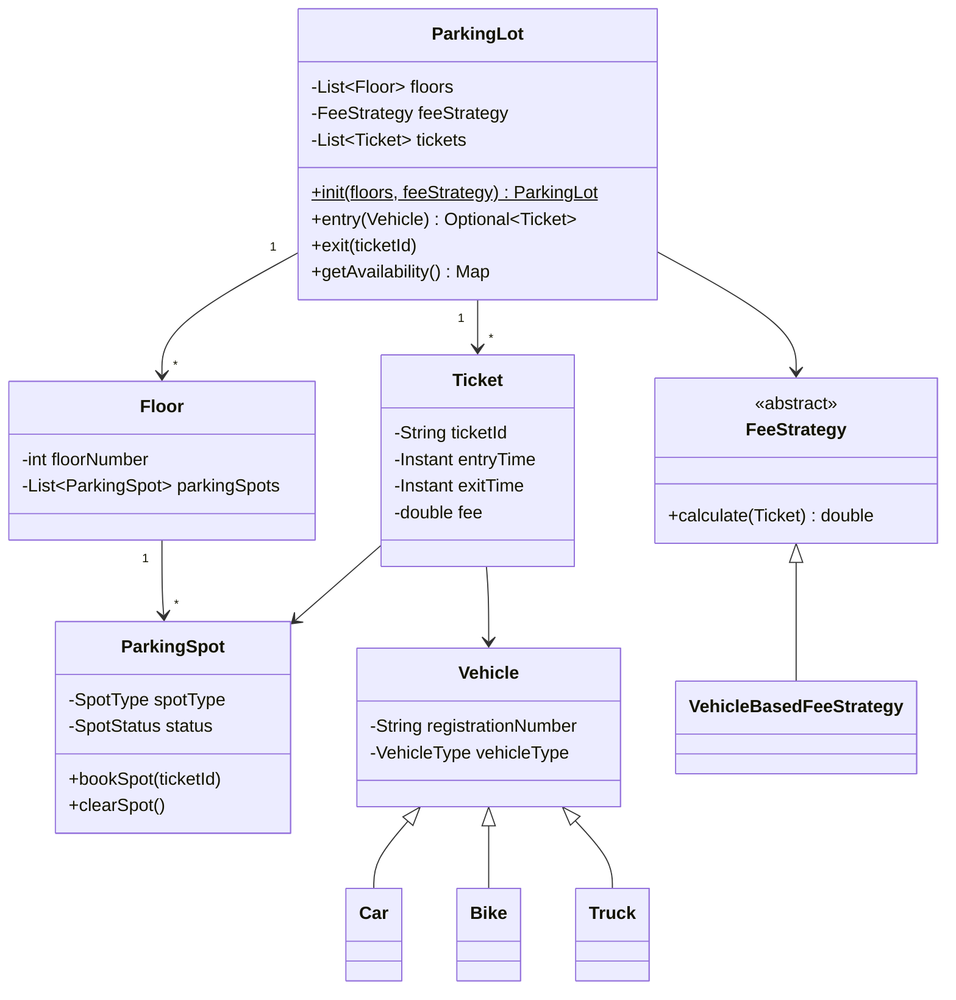

# Parking Lot

> Type: LLD · Status: ✅ Done

## 1. Requirements

### Functional
- Multiple floors, each with SMALL, MEDIUM and LARGE spots
- Supports BIKE, CAR and TRUCK (bike → small, car → medium, truck → large)
- Issue a ticket on entry; reject the vehicle if no compatible spot is free
- On exit, free the spot and charge a fee based on vehicle type and hours parked
- Show current availability per spot type

### Non-functional
- Single parking lot instance (Singleton)
- Fee calculation should be swappable without touching `ParkingLot`

## 2. Core Entities

| Entity | Responsibility |
|--------|----------------|
| `Vehicle` (`Car`, `Bike`, `Truck`) | Registration number + vehicle type |
| `ParkingSpot` | Spot type, status, current ticket |
| `Floor` | Holds a list of spots |
| `Ticket` | Vehicle, spot, entry/exit time, fee |
| `ParkingLot` | Entry, exit, spot lookup, availability |
| `ParkingLotFactory` | Builds floors and spots |
| `FeeStrategy` | Calculates the fee for a ticket |

## 3. Class Diagram



## 4. Package Structure

```
src/parkinglot/
  Main.java      demo of a day at the lot
  enums/         SpotStatus, SpotType, VehicleType
  models/        Vehicle, Car, Bike, Truck, ParkingSpot, Floor, Ticket
  strategy/      FeeStrategy, VehicleBasedFeeStrategy
  system/        ParkingLot, ParkingLotFactory
```

## 5. Design Patterns Used

| Pattern | Where | Why |
|---------|-------|-----|
| Singleton | `ParkingLot.init()` / `getInstance()` | One lot per system; double-checked locking |
| Strategy | `FeeStrategy` | Swap pricing (hourly, flat, weekend) without changing `ParkingLot` |
| Factory | `ParkingLotFactory.createFloors()` | Keeps floor/spot setup out of `ParkingLot` |

## 6. Key Flows
1. **Entry:** map vehicle type → spot type → find first free spot → create `Ticket` → book spot
2. **Exit:** look up ticket → clear spot → set exit time → `feeStrategy.calculate()` → set fee

## 7. Edge Cases
- No compatible spot free → `Optional.empty()`, vehicle turned away
- Invalid ticket ID on exit → `IllegalArgumentException`
- Partial hours are rounded up (`hours + 1`)

## 8. Possible Extensions
- Spot-finding strategy (nearest to gate, lowest floor first)
- Let smaller vehicles use bigger spots when their type is full
- Multiple entry/exit gates and concurrent entry (thread safety on `findSpot` + `bookSpot`)
- Payment methods (cash, card, UPI)
- Electric-vehicle charging spots

## 9. How to Run

```bash
cd lld/parking-lot
javac -d out $(find src -name "*.java")
java -cp out parkinglot.Main
```
