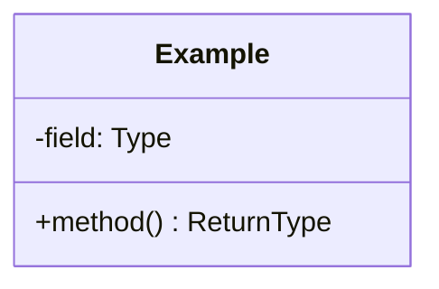

# <Problem Name>

> Type: LLD | HLD · Status: 🚧 In progress / ✅ Done

## 1. Requirements

### Functional
- 

### Non-functional
- 

### Out of scope
- 

## 2. Core Entities

| Entity | Responsibility |
|--------|----------------|
|        |                |

## 3. Class Diagram



## 4. Package Structure

```
src/<problemname>/
  Main.java
  enums/
  models/
  strategy/
  service/
```

## 5. Design Patterns Used

| Pattern | Where | Why |
|---------|-------|-----|
|         |       |     |

## 6. Key Flows
1. 

## 7. Edge Cases
- 

## 8. Possible Extensions
- 

## 9. How to Run

```bash
cd lld/<problem-name>
javac -d out $(find src -name "*.java")
java -cp out <problemname>.Main
```
